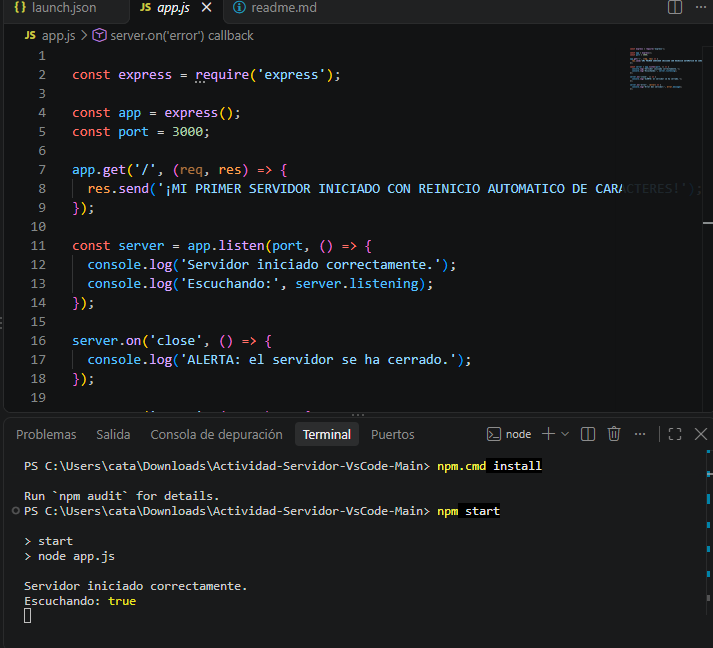
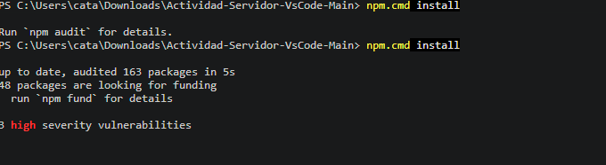
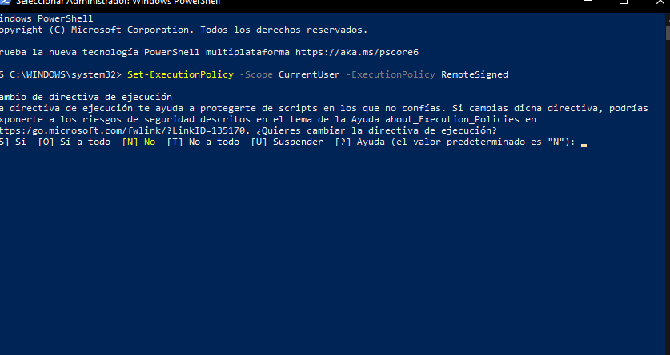
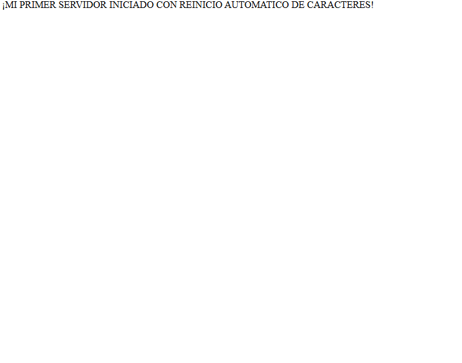
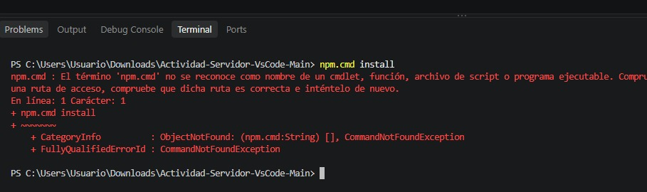

1 primera imagen: en esta imagen se puede ver el servidor ya iniciado hay que utilizar el codigo de npm star para que esta misma se ejecute en el navegador.

2 segunda imagen: 
en la segunda imagen tenemos que escribir el siguiente comando npm.cdm para que salga el servidor por que sin esto el servidor no funciona y pues aparece apagado 

3 imagen:
esta imagen muestra que tenemos que quitar los permisos por que si no se quitan obviamente no va dejar activar el servidor.
4 imagen:finalmente tenemos nuestro servidor en funcionamiento cuando no esta en funcionamiento es por esta apagado automaticamente se apaga por que aun no contamos con los permisos de una pagina verdaderamente.

## FALLOS QUE TUBE AL REALIZAR LA ACTIVIDAD:

- ese error salio por que nose ejecuto por que nos mostro error al installar al poner el install cdm.

- este fallo sucedio por una mala vinculacion entre vs code y el http://localhost:3000 por malos comandos en la terminal integrada.